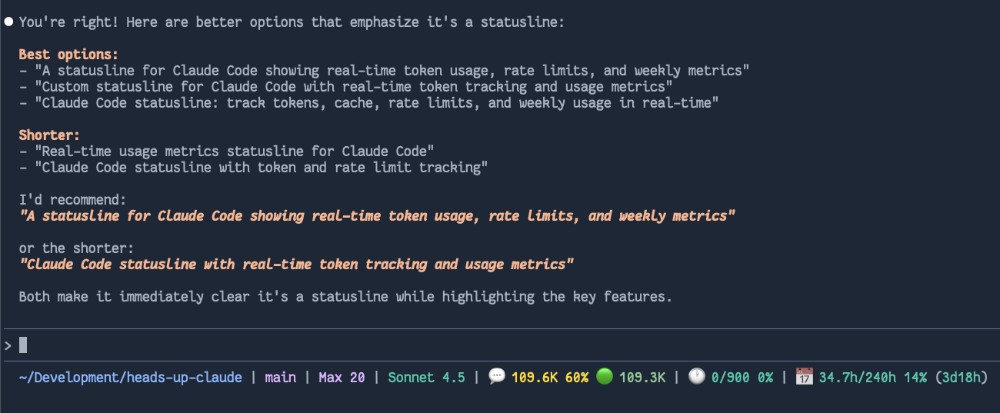

# Heads Up Claude

A statusline for Claude Code showing real-time token usage, rate limits, and weekly metrics extracted directly from Claude's usage data.



## Features

- **Token Usage Tracking**: Real-time conversation context size with cache read tokens
- **5-Hour Rate Limit**: Live session usage percentage and reset time from Claude's API
- **Weekly Usage**: Live weekly usage percentage and reset time from Claude's API
- **API-Based Data**: Fetches accurate usage data directly from Claude.ai (with optional credentials)
- **Privacy-Focused**: Credentials stored locally, no third-party services
- **Fallback Estimates**: Uses local transcript analysis if API unavailable
- **Customizable Display**: Choose between emoji icons or descriptive text

## Installation

### Quick Install (Recommended)

```bash
git clone https://github.com/axiomantic/heads-up-claude.git
cd heads-up-claude
bash install.sh
```

The install script will:
1. Auto-detect existing Claude config directories in your home directory
2. Prompt you to select which directory to install into
3. Check if Nim is installed (and offer to install it if not)
4. Build the binary and install it to `~/.local/bin/`
5. Install the usage data extraction script (`get_usage.exp`)
6. Prompt you to configure:
   - Your Claude plan (Free, Pro, Max 5×, or Max 20×)
   - Optional custom tag prefix for the statusline
   - Tag color (if using a custom tag)
   - Display style (emoji icons or text labels)
7. Configure your selected Claude config directory's `settings.json`

**Note**: Nim 2.0.0 or higher is required. Visit https://nim-lang.org/install.html for installation instructions.

### Upgrading

```bash
cd heads-up-claude
git pull
bash install.sh
```

### Uninstalling

```bash
bash uninstall.sh
```

This removes:
- Binary (`~/.local/bin/heads-up-claude`)
- Expect script (`~/.local/bin/get_usage.exp`)
- Config file (`~/.claude/heads_up_config.json`)
- Cache directory (`$TMPDIR/heads-up-claude`)
- `statusLine` entry from `~/.claude/settings.json` (requires `jq`)

## Real-Time Usage Data (Recommended)

For accurate, real-time usage data from Claude's servers, run the setup wizard:

```bash
~/.local/bin/heads-up-claude --setup-api
```

This will:
1. Open claude.ai in your browser
2. Show you a JavaScript snippet to run in the browser console
3. Wait for you to paste the credentials
4. Save them to your config file

### Credential Expiration

Session keys expire periodically. When this happens, your statusline will show:

```
[credentials expired: heads-up-claude --setup-api]
```

Just run the setup command again to refresh your credentials.

### Multiple Claude Configs

If you use multiple Claude config directories (e.g., work and personal), specify the directory:

```bash
heads-up-claude --setup-api --claude-config-dir=~/.claude-work
```

### How it Works

With API credentials configured:
- Usage data is fetched directly from `claude.ai/api/organizations/{orgId}/usage`
- Shows real 5-hour and weekly utilization percentages from Anthropic's servers
- Cached for 60 seconds to avoid excessive API calls
- Falls back to transcript-based estimates if API fails

### Without API Credentials

The statusline will show `~estimates` and use local transcript analysis to approximate your usage. This works but is less accurate than the API-based approach.

## Understanding the Statusline

The statusline displays several key metrics to help you manage your Claude Code usage:

```
[ personal ] | ~/Development/project | feature-branch | Max 20 | Sonnet 4.5 | 💬 104.6K 65% 🟢 104.0K | 🕐 9/900 1% (5h) | 📅 50.4h/240h 21% (2d3h)
<custom tag> | <directory>          | <branch>        | <plan> | <model>    | <session tokens>       | <5-hour usage> | <weekly usage>
```

### Components

- **Custom Tag** (optional, customizable color): Personal identifier for this workspace (e.g., "personal", "work", "dev")
- **Project Directory** (blue): Current working directory
- **Git Branch** (magenta): Active git branch if in a repository
- **Plan Tier** (magenta): Your Claude plan (Free, Pro, Max 5, or Max 20)
- **Model** (cyan): Current model (🧠 emoji appears if thinking mode is enabled)

### 💬 Conversation Context (Session Tokens)

Shows the current conversation's token count and percentage of the auto-compact threshold (default: 160K tokens).

- Tracks actual context size from most recent API call
- Includes cache read tokens + new tokens from last exchange
- Color-coded warnings:
  - Yellow (normal)
  - Red (≥80%)
  - Bright red with ⚠️ (≥90%)
- Resets to zero after `/clear` or reduces after `/compact`

**Example**: `💬 104.6K 65% 🟢 104.0K` means 104,600 tokens used (65% of 160K threshold), with 104,000 tokens read from cache

### 🕐 5-Hour Rate Limit

Claude enforces message limits per rolling 5-hour window. This shows your current usage extracted directly from Claude's internal data:

- Reads actual session usage percentage from `claude /config`
- Shows percentage used and time until reset
- Automatically detects your plan tier (no configuration needed)
- **Plan Limits**:
  - Pro: 45 messages per 5 hours
  - Max 5×: 225 messages per 5 hours
  - Max 20×: 900 messages per 5 hours

**Example**: `🕐 9/900 1% (5h)` means 9 messages used out of 900 allowed (1% of your limit), with 5 hours until reset.

### 📅 Weekly Usage

Claude tracks weekly usage hours (session duration, not wall clock time). This shows your progress extracted directly from Claude's internal data:

- Reads actual weekly usage percentage from `claude /config`
- Shows percentage used and time until weekly reset
- Automatically detects your plan tier and weekly limits
- **Plan Limits**:
  - Pro: 40-80 hours/week
  - Max 5×: 140-280 hours/week
  - Max 20×: 240-480 hours/week

**Example**: `📅 50.4h/240h 21% (2d3h)` means 50.4 hours used out of 240 hours allowed (21% of your weekly limit), with 2 days 3 hours until reset.

## How It Works

The statusline extracts real usage data using a priority-based approach:

1. **API Method (Preferred)**: If you've configured API credentials (see above), the statusline fetches usage data directly from `https://claude.ai/api/organizations/{orgId}/usage`
   - Returns actual 5-hour and weekly utilization percentages
   - Includes accurate reset times
   - Cached for 60 seconds to avoid excessive API calls

2. **Fallback: Transcript Estimation**: If API credentials aren't configured or the API fails, the statusline estimates usage from local transcript files in `~/.claude/projects/` and displays a `~estimates` indicator.

**Performance**: API calls are fast (~100-200ms) and cached. The statusline updates on each prompt.

## Configuration

### Command Line Options

- `--no-emoji` - Use text labels (CTX, 5HR, WK) instead of emoji
- `--help` - Show help message
- `--install` - Run interactive installer
- `--claude-config-dir=<path>` - Claude config directory (default: $CLAUDE_CONFIG_DIR or ~/.claude)
- `--tag=TEXT` - Prepend custom tag to statusline
- `--tag-color=COLOR` - Color for custom tag

### Manual Configuration

Edit `~/.claude/settings.json`:

```json
{
  "statusLine": {
    "type": "command",
    "command": "~/.local/bin/heads-up-claude --tag=\"personal\" --tag-color=\"bright-cyan\""
  }
}
```

Available tag colors: `black`, `red`, `green`, `yellow`, `blue`, `magenta`, `cyan`, `white`, `gray`, `bright-red`, `bright-green`, `bright-yellow`, `bright-blue`, `bright-magenta`, `bright-cyan`, `bright-white`

**Note**: The statusline shows `~estimates` when it falls back to local transcript analysis (if usage data extraction fails).

**Windows users**: Use the full path like `C:\Users\YourName\AppData\Local\Programs\heads-up-claude.exe`

### Plan Configuration

During installation, you'll be prompted to configure your Claude plan. This is used as a fallback when real usage data is unavailable:

1. **Free**: 10 messages per 5 hours
2. **Pro** ($20/month): 45 messages per 5 hours, ~40 hours per week
3. **Max 5×** ($100/month): 225 messages per 5 hours, ~140 hours per week
4. **Max 20×** ($200/month): 900 messages per 5 hours, ~240 hours per week

The configuration is saved to `~/.claude/heads_up_config.json` and can be updated by running `~/.local/bin/heads-up-claude --install` again.

**Note**: When real usage data is extracted from Claude, these configured limits are not used - the actual percentages and reset times from Claude are displayed instead.

## Development

### Building from Source

```bash
nimble build    # Release build
nimble dev      # Debug build
```

### Project Structure

```
heads-up-claude/
├── src/
│   ├── heads_up_claude.nim    # Main entry point
│   ├── types.nim              # Type definitions
│   ├── usage.nim              # Usage extraction and calculation
│   ├── display.nim            # Statusline formatting
│   ├── installer.nim          # Installer functions
│   └── nim.cfg                # Compiler config
├── tests/                     # Test files
├── get_usage.exp              # Expect script for extracting usage from Claude
├── install.sh                 # Unified install script
├── heads_up_claude.nimble     # Package definition
├── README.md
├── CHANGELOG.md
└── LICENSE
```

### Running Tests

```bash
nimble test
```

## Contributing

Contributions are welcome! Please feel free to submit a Pull Request.

## License

MIT License - see [LICENSE](LICENSE) for details.

## Version

Current version: **0.2.0** (2025-01-09)

See [CHANGELOG.md](CHANGELOG.md) for version history.
